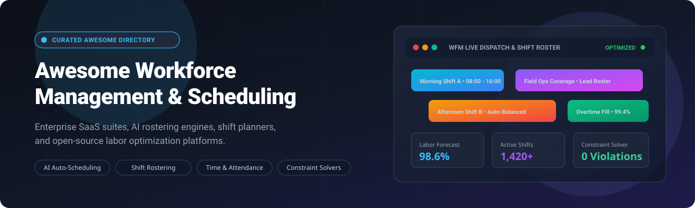

<p align="center">
  
</p>

# ⏰ Awesome Workforce Management & Scheduling 📅

<a href="https://github.com/ishandutta2007/Awesome-Awesome-Awesome"></a><a href="https://discord.gg/jc4xtF58Ve"></a>
[](https://github.com/ishandutta2007/Awesome-Awesome-Awesome)
[](https://creativecommons.org/publicdomain/zero/1.0/)
[](CONTRIBUTING.md)
[](https://github.com/ishandutta2007)
<a href="https://github.com/ishandutta2007"></a>

> **🚀 A comprehensive, SEO-optimized curated directory of Workforce Management (WFM) software, employee scheduling tools, automated shift rostering platforms, labor optimization engines, and open-source self-hosted solutions.** 🌟

Whether you are managing hourly staff in restaurants 🍽️, healthcare facilities 🏥, and retail stores 🛍️, or architecting large-scale enterprise shift planning algorithms with constraint solvers 🧠, this guide provides side-by-side pricing 💵, company scale benchmarks 📊, free tier limits 🎁, and GitHub activity metrics ⭐.

---

## 📑 Table of Contents

- [📈 Sector Overview & Market Dynamics](#-sector-overview--market-dynamics)
- [🏢 Commercial & SaaS Solutions](#-commercial--saas-solutions)
  - [📊 SaaS Solutions Comparison Matrix](#-saas-solutions-comparison-matrix)
  - [🔍 Detailed SaaS Platform Highlights](#-detailed-saas-platform-highlights)
- [💻 Open-Source & Self-Hosted Software](#-open-source--self-hosted-software)
  - [⭐ Open-Source Solutions Comparison](#-open-source-solutions-comparison)
  - [🛠️ Detailed Open-Source Project Highlights](#️-detailed-open-source-project-highlights)
- [🎯 Key Selection Criteria for WFM Systems](#-key-selection-criteria-for-wfm-systems)
- [🌟 Star History](#-star-history)
- [💖 Support & Sponsorship](#-support--sponsorship)
- [🤝 Contributing](#-contributing)
- [📄 License](#-license)

---

## 📈 Sector Overview & Market Dynamics

The global Workforce Management (WFM) software market is valued at approximately **$9.3B–$11.7B in 2025** 🌐 and is projected to expand to **$13B–$17.2B+ by 2030** 🚀, growing at a steady Compound Annual Growth Rate (CAGR) of **8.5% to 10.1%** 📈.

The sector exhibits a **hybrid market structure: highly concentrated among multi-billion-dollar conglomerates at the enterprise tier (e.g., UKG, Workday, Paylocity, SAP, Oracle) 🏛️, yet distinctly fragmented at the mid-market and SME levels** 🧩, where hundreds of vertical-specific and mobile-first point solutions compete aggressively on AI shift auto-scheduling 🤖, POS/payroll connectors 🔗, and frontline worker experience 📱.

---

## 🏢 Commercial & SaaS Solutions

Commercial cloud-hosted workforce management suites engineered for automated shift generation 🗓️, GPS geofenced timeclocks 📍, break/overtime compliance ⚖️, and payroll synchronization 💳.

### 📊 SaaS Solutions Comparison Matrix

*The table below is ordered by company scale (enterprise valuation / market capitalization / revenue) in descending order 📉.*

| 🏢 Platform | 💰 Company Scale (Valuation / Revenue) | 🏷️ Starting Tier Pricing | 🎁 Free Tier / Free Trial Limits | ⚡ Key Specialization | 🎯 Target Organization |
| :--- | :--- | :--- | :--- | :--- | :--- |
| **[UKG Pro WFM](https://www.ukg.com)** | **~$22B Valuation** (~$4.7B annual revenue) | **$26.00 / employee / month** (enterprise WFM suite estimate) | **No free tier**; No self-serve trial (custom enterprise sales demo & RFP scoping only) | AI agent workforce orchestration (Bryte AI), complex union compliance, multi-country payroll | Large enterprises, healthcare hospital networks, global manufacturing |
| **[Paylocity](https://www.paylocity.com)** | **~$9.2B Market Cap** (~$1.7B annual revenue) | **$22.00 / employee / month** (all-in HCM & scheduling base) | **No free tier**; No public self-serve trial (custom live guided product demo only) | Unified HCM, mobile self-service shift swaps, geofenced mobile timeclock, payroll | Mid-to-enterprise organizations desiring all-in-one HR + scheduling |
| **[Zoho People](https://www.zoho.com/people/)** | **~$1.5B Revenue** (FY25: ₹12,313 Cr bootstrapped) | **$2.00 / user / month** billed annually ($2.50 monthly; Professional tier for shift rostering) | **Free forever plan**: up to 5 users (basic HR & leave tracking); **15-day free trial** for paid tiers (no credit card required) | Comprehensive HR suite with attendance tracking, shift assignments, and modular Zoho One integration | Small-to-mid companies already in the Zoho ecosystem |
| **[When I Work](https://wheniwork.com)** | **~$1.1B Valuation** (~$35M annual revenue) | **$2.50 / user / month** (Standard Scheduling single-location) | **14-day free trial** (unrestricted access to shift builder, GPS clock-in, team messaging; no forever-free tier) | Intuitive mobile shift scheduling, GPS timeclock, auto-scheduling rules, on-demand shift trading | Shift-based SMBs, retail stores, clinics, hospitality |
| **[Deputy](https://www.deputy.com)** | **~$1.1B Valuation** (~$100M annual revenue) | **$4.50 / user / month** billed annually ($5.00 monthly for Scheduling tier; $6.00 for Premium) | **31-day free trial** (unlimited access to shift scheduling & time tracking; max 100 SMS notifications included) | Shift rostering, labor cost alerts, break compliance, and weekly active-user "Flexi" pricing | Variable-hour shift teams, retail chains, seasonal businesses |
| **[Quinyx](https://www.quinyx.com)** | **~$750M Valuation** (~$55M annual revenue) | **$5.00 / user / month** (estimated base tier for core WFM modules) | **14-day guided proof-of-concept / sandbox trial** (available upon consultation; no public forever-free tier) | AI-powered hyper-local demand forecasting, automated algorithmic schedule generation, labor optimization | Multi-site retail chains, logistics distribution centers, frontline operations |
| **[Homebase](https://joinhomebase.com)** | **~$550M Valuation** (~$60M annual revenue) | **$24.00 / location / month** billed annually ($30 monthly base for Essentials tier) | **Free forever Basic plan**: 1 physical location and up to 10 employees (basic scheduling & time clock); **14-day free trial** on paid tiers | Flat per-location pricing, geofenced mobile clock-in, automated shift reminders, POS sales sync | Single-location and local SMBs (cafes, boutique retail, small salons) |
| **[TCP Humanity](https://www.tcpsoftware.com/humanity-schedule)** | **~$240M Revenue** (Providence Equity backed) | **$2.75 / user / month** (Essentials tier billed annually) | **30-day free trial** (full access to dynamic scheduling, auto-fill, and mobile shift management; no forever-free tier) | Predictive scheduling, automated dynamic schedule generation, employee skill/credential rule-checking | Healthcare clinics, hospitality, emergency services, distributed teams |
| **[7shifts](https://www.7shifts.com)** | **~$130M Funding** (~$70M annual revenue) | **$39.99 / location / month** billed annually ($44.99 monthly for Essentials tier) | **Free forever Comp plan**: 1 location and up to 10 employees (basic shift scheduling); **14-day free trial** for paid plans | Restaurant-specific POS sales labor forecasting, tip pooling, compliance meal-break rules | Restaurants, bars, ghost kitchens, hospitality franchises |
| **[Sling](https://getsling.com)** | **~$60.6M Acquisition** (Acquired by Toast) | **$1.70 / user / month** billed annually ($2.00 monthly for Premium tier) | **Free forever Basic plan**: up to 30 users (unlimited shifts, shift templates, newsfeed); **14-day free trial** on Premium/Business tiers | Visual shift scheduling, built-in employee communication channels, labor cost budgeting | Small-to-medium teams wanting a generous free tier for up to 30 workers |

---

### 🔍 Detailed SaaS Platform Highlights

#### 🏢 UKG Pro Workforce Management
- **Overview:** Enterprise-grade workforce management and human capital management suite powered by Bryte AI agents 🤖.
- **Key Capabilities:** Real-time labor compliance enforcement (mandated break windows, overtime caps, union agreements) ⚖️, multi-country payroll integration 🌐, demand-driven schedule generation 📈.
- **Best Fit:** Global multi-site enterprises in manufacturing, healthcare systems, and national retail chains.

#### 💼 Paylocity
- **Overview:** Integrated cloud HCM and payroll platform offering integrated time, attendance, and shift scheduling 📱.
- **Key Capabilities:** Shift claiming and trading from native mobile apps 🔄, GPS geofenced clock-in 📍, labor budget tracking 💰, integrated tax filing and direct deposit payroll 💳.
- **Best Fit:** Mid-market organizations aiming to consolidate standalone scheduling tools into an all-in-one payroll and HR platform.

#### 👥 Zoho People
- **Overview:** Modular HRMS with structured shift planning, biometric attendance integration, and employee self-service 📑.
- **Key Capabilities:** Shift rotation scheduling 🔄, leave/holiday calendar synchronization 📅, timesheet approval hierarchies ✔️, Zia AI bot assistants 🤖.
- **Best Fit:** Organizations already utilizing Zoho CRM, Zoho Books, or Zoho One looking for cost-effective shift tracking.

#### ⏱️ When I Work
- **Overview:** Mobile-first shift builder designed for deskless and shift-based teams 📲.
- **Key Capabilities:** One-click schedule publishing ⚡, SMS/push shift notifications 🔔, shift swaps with manager approval workflows 🤝, geofenced mobile time clocking ⏱️.
- **Best Fit:** Fast-moving hospitality, clinic, and retail businesses seeking quick setup without lengthy implementation cycles.

#### 📋 Deputy
- **Overview:** Global scheduling and time tracking software known for labor compliance and flexible pricing 🌐.
- **Key Capabilities:** Fair Workweek compliance warnings ⚠️, automated wage calculation against overtime laws 💵, stress-free shift replacement 🔄, Flexi pricing for seasonal workers 👥.
- **Best Fit:** Businesses with dynamic, fluctuating, or seasonal headcounts needing automated legal compliance checks.

#### 🧠 Quinyx
- **Overview:** AI-first workforce management system emphasizing automated mathematical optimization and demand forecasting 🔮.
- **Key Capabilities:** Deep learning demand prediction based on footfall and weather 🌤️, automated shift optimization against employee preferences 🎯, real-time absence cover 🛡️.
- **Best Fit:** Complex retail, transport, and logistics companies with hundreds of employees per site.

#### 🏠 Homebase
- **Overview:** Small-business operating system combining time clocks, scheduling, and local hiring ☕.
- **Key Capabilities:** Location-based flat pricing (independent of employee headcount) 🏷️, POS timecard sync (Clover, Square, Toast) 💳, automated labor compliance notifications 📋.
- **Best Fit:** Independent local shops, cafes, restaurants, and medical practices with 1–2 physical locations.

#### 🏥 TCP Humanity (Humanity Schedule)
- **Overview:** Cloud employee scheduling platform engineered by TCP Software for dynamic operations 🚑.
- **Key Capabilities:** Conflict management algorithms 🚫, skill and certification verification before shift assignment 📜, automated break staggered schedules ☕.
- **Best Fit:** Organizations with certified staff requirements (e.g., healthcare providers, emergency response, universities).

#### 🍴 7shifts
- **Overview:** Dedicated workforce management software tailored exclusively for the restaurant and hospitality sector 🍕.
- **Key Capabilities:** Real-time sales vs. labor percentage tracking via POS integrations 📊, tip pooling calculation 💵, break compliance ⏱️, team chat 💬.
- **Best Fit:** Single-location restaurants through enterprise multi-unit hospitality operators.

#### 💬 Sling
- **Overview:** Visual scheduling and employee communication app built for shift-based businesses 🗣️.
- **Key Capabilities:** Drag-and-drop roster builder 🖱️, recurring shift templates 📄, internal messaging wall 🗨️, overtime warning alerts ⚠️.
- **Best Fit:** Budget-conscious managers looking for a clean UI and up to 30 free seats.

---

## 💻 Open-Source & Self-Hosted Software

Self-hosted, transparent, and auditable open-source platforms for shift scheduling 🗓️, constraint-based roster optimization 🧩, and workforce time tracking ⏱️.

### ⭐ Open-Source Solutions Comparison

*The table below is ordered by GitHub Stars_Count in descending order 🌟. Click on the badge to visit the stargazers page of the repository.*

| 📦 Project | ⭐ GitHub_Stars | 🛠️ Tech Stack | 📜 License | 🎯 Core Focus | 🏗️ Architecture / Deployment |
| :--- | :--- | :--- | :--- | :--- | :--- |
| **[ActivityWatch](https://github.com/ActivityWatch/activitywatch)** | [](https://github.com/ActivityWatch/activitywatch/stargazers) | Python, Rust, Vue.js | MPL-2.0 | Privacy-first automated time & activity tracking | Cross-platform desktop daemon + web UI (Docker / Local) |
| **[Frappe HR](https://github.com/frappe/hrms)** | [](https://github.com/frappe/hrms/stargazers) | Python, Frappe, MariaDB, JS | GPL-3.0 | Complete open-source HRMS, shift types & attendance | Monolithic framework (Docker, Bench, Kubernetes) |
| **[solidtime](https://github.com/solidtime-io/solidtime)** | [](https://github.com/solidtime-io/solidtime/stargazers) | PHP, Laravel, Vue 3, Tailwind | AGPL-3.0 | Modern team time tracking, billing rates & project tracking | Docker Compose, self-hosted web app |
| **[Kimai](https://github.com/kimai/kimai)** | [](https://github.com/kimai/kimai/stargazers) | PHP, Symfony, MySQL, Doctrine | AGPL-3.0 | Comprehensive time tracking, invoicing, budget control | Docker, LAMP/LEMP stack |
| **[OptaPlanner (Legacy)](https://github.com/apache/incubator-kie-optaplanner)** | [](https://github.com/apache/incubator-kie-optaplanner/stargazers) | Java, Quarkus, Spring Boot | Apache-2.0 | AI constraint solver for employee rostering & shift planning | Embeddable solver library / microservice engine |
| **[Timefold Solver](https://github.com/TimefoldAI/timefold-solver)** | [](https://github.com/TimefoldAI/timefold-solver/stargazers) | Java, Kotlin, Python | Apache-2.0 | Next-generation constraint optimization engine for shift rostering | Java library, Quarkus / Spring Boot microservice |
| **[Staffjoy V2](https://github.com/Staffjoy/v2)** | [](https://github.com/Staffjoy/v2/stargazers) | Go, React, Python, Docker | Apache-2.0 | Microservices-based small business shift scheduling | Kubernetes / Docker microservices architecture |
| **[Traggo](https://github.com/traggo/server)** | [](https://github.com/traggo/server/stargazers) | Go, GraphQL, TypeScript | GPL-3.0 | Tag-based self-hosted time tracking engine | Single Go binary, SQLite / MySQL, Docker |
| **[Horilla HR](https://github.com/horilla-opensource/horilla)** | [](https://github.com/horilla-opensource/horilla/stargazers) | Python, Django, PostgreSQL | LGPL-3.0 | Free self-hosted HR, geofenced attendance, leave management | Docker Compose, Django standard deploy |
| **[OrangeHRM](https://github.com/orangehrm/orangehrm)** | [](https://github.com/orangehrm/orangehrm/stargazers) | PHP, Symfony, MySQL | GPL-2.0 | Enterprise open-source HR platform, timecards & attendance | Traditional LAMP stack / Docker |
| **[Timefold Quickstarts](https://github.com/TimefoldAI/timefold-quickstarts)** | [](https://github.com/TimefoldAI/timefold-quickstarts/stargazers) | Java, Python, TypeScript | Apache-2.0 | Ready-to-run employee rostering and shift constraint templates | Standalone runnable Maven/Gradle/Python templates |
| **[employee-scheduling-ui](https://github.com/martinmicunda/employee-scheduling-ui)** | [](https://github.com/martinmicunda/employee-scheduling-ui/stargazers) | Angular, TypeScript, CSS3 | MIT | Front-end calendar UI component for shift rosters | Standalone Angular UI library |
| **[OpenSkedge](https://github.com/OfficeStack/OpenSkedge)** | [](https://github.com/OfficeStack/OpenSkedge/stargazers) | PHP, Symfony, Doctrine | AGPL-3.0 | Flexible employee scheduling tailored for fluid shift teams | LAMP/LEMP web server |
| **[Cattr Server](https://github.com/cattr-app/server-application)** | [](https://github.com/cattr-app/server-application/stargazers) | PHP, Laravel, Vue.js, Electron | GPL-3.0 | Self-hosted time tracker with desktop activity screenshots | Docker Compose, standalone web server |
| **[pyworkforce](https://github.com/rodrigo-arenas/pyworkforce)** | [](https://github.com/rodrigo-arenas/pyworkforce/stargazers) | Python | MIT | Python library for workforce planning, Erlang queuing & rostering | Python package (`pip install pyworkforce`) |

---

### 🛠️ Detailed Open-Source Project Highlights

#### 🔒 ActivityWatch
- **Repo:** [ActivityWatch/activitywatch](https://github.com/ActivityWatch/activitywatch)  
- **Description:** An open-source, privacy-first automated time tracker. It runs locally in the background across Linux, Windows, macOS, and Android, recording active window contexts and application usage without cloud tracking 🛡️.  
- **Best For:** Developers, remote workers, and privacy-conscious teams needing transparent audit trails of time allocation.

#### 👥 Frappe HR (ERPNext HRMS)
- **Repo:** [frappe/hrms](https://github.com/frappe/hrms)  
- **Description:** The leading enterprise-grade open-source HR and payroll platform. Offers comprehensive shift management, shift type configuration, automatic roster assignments, biometric device integration, and salary slip computation 📑.  
- **Best For:** Mid-size businesses seeking a self-hosted alternative to Workday or BambooHR with integrated shift rostering.

#### ⏱️ solidtime
- **Repo:** [solidtime-io/solidtime](https://github.com/solidtime-io/solidtime)  
- **Description:** A modern, beautifully designed open-source time-tracking platform built with Laravel and Vue 3. Features multi-organization support, granular project billing rates, team member tracking, and modern REST APIs 🎨.  
- **Best For:** Software agencies, consultancies, and distributed engineering teams wanting a self-hosted Toggl alternative.

#### 📊 Kimai
- **Repo:** [kimai/kimai](https://github.com/kimai/kimai)  
- **Description:** A battle-tested open-source time tracker built on Symfony and Doctrine. Tracks worked hours, calculates expenses, creates PDF/Excel invoices, and provides role-based permission control 💼.  
- **Best For:** Organizations that need compliant time tracking and billing exports without per-seat SaaS costs.

#### 🧩 Timefold Solver
- **Repo:** [TimefoldAI/timefold-solver](https://github.com/TimefoldAI/timefold-solver)  
- **Description:** The open-source AI constraint solver (forked from OptaPlanner) written in Java and Python. Capable of solving complex NP-hard employee rostering challenges by balancing hard constraints (maximum work hours, rest periods, certifications) and soft constraints (shift preferences, fair weekend distribution) ⚙️.  
- **Best For:** Engineering teams building custom enterprise scheduling applications with complex operational constraints.

#### 📦 Staffjoy V2
- **Repo:** [Staffjoy/v2](https://github.com/Staffjoy/v2)  
- **Description:** An open-source microservices architecture for shift scheduling originally built by Staffjoy. Includes services for scheduling, users, notification dispatch, and web frontends 🚀.  
- **Best For:** Developers wanting an architectural blueprint for building scalable, cloud-native scheduling microservices.

#### 🏷️ Traggo
- **Repo:** [traggo/server](https://github.com/traggo/server)  
- **Description:** A tag-based self-hosted time-tracking engine with a clean GraphQL API. Instead of rigid client/project hierarchies, Traggo uses flexible key-value tags to classify time entries 🏷️.  
- **Best For:** Self-hosters looking for a lightweight, single-binary time tracker.

#### 🐍 Horilla HR
- **Repo:** [horilla-opensource/horilla](https://github.com/horilla-opensource/horilla)  
- **Description:** A free, modular open-source HR software written in Python and Django. Features geofenced employee check-ins, attendance tracking, shift assignment calendars, and onboarding pipelines 📝.  
- **Best For:** Teams seeking an extensible Python/Django codebase for internal HR operations.

#### 🧮 pyworkforce
- **Repo:** [rodrigo-arenas/pyworkforce](https://github.com/rodrigo-arenas/pyworkforce)  
- **Description:** A specialized Python library providing mathematical algorithms for workforce management: Erlang C queuing models for call center staffing, shift scheduling solvers, and multi-skill employee rostering 🔬.  
- **Best For:** Data scientists, industrial engineers, and operations research specialists modeling workforce requirements in Python.

---

## 🎯 Key Selection Criteria for WFM Systems

When evaluating workforce management and employee scheduling platforms, consider the following technical and operational dimensions:

1. **Scheduling Constraints vs. Visual Calendars 🗓️:**
   - Simple drag-and-drop calendars (e.g., Homebase, Sling, When I Work) work well for teams under 50 with straightforward shifts.
   - Algorithmic constraint solvers (e.g., Timefold, Quinyx, UKG) are essential when dealing with 100+ workers, union rules, skill certifications, and multi-jurisdictional labor regulations.
2. **Pricing Structure (Per-User vs. Per-Location) 💳:**
   - Single-location retail shops and restaurants benefit most from flat per-location pricing (Homebase, 7shifts).
   - Distributed remote or office teams typically benefit from per-user seat pricing (When I Work, Deputy, Sling).
3. **Data Sovereignty & Privacy 🔐:**
   - Organizations handling sensitive employee biometric records or requiring zero third-party telemetry should choose self-hosted solutions like Frappe HR, Kimai, or solidtime.
4. **Timeclock Integrity 📍:**
   - Evaluate geofencing accuracy, offline punch caching, mobile beacon support, and biometric terminal integrations to prevent buddy punching.

---

## 🌟 Star History

[](https://star-histrry.dera.page/#ishandutta2007/Awesome-Workforce-Management-Scheduling&type=date&legend=top-left)

---

## 💖 Support & Sponsorship

If you find this curated directory useful for your team, organization, or research, please consider supporting the project! 🌟

- ⭐ **Star this repository** to help others discover it on GitHub.
- 🍴 **Fork and contribute** tools, libraries, or price updates.
- 📢 **Share with colleagues** in HR tech, workforce operations, and engineering.
- ☕ **Buy a coffee / Sponsor the author** via GitHub Sponsors:
  
  [](https://github.com/sponsors/ishandutta2007)

---

## 🤝 Contributing

Contributions are warmly welcomed! 💡 Please read the guidelines below before opening a pull request:

- **Adding a Commercial Solution:** Must include verified starting tier pricing, transparent free tier or trial limits, and company scale metrics 📊.
- **Adding an Open-Source Project:** Must link to an active public repository, specify the tech stack, license, and include the standard social Stars_Badge ⭐.
- **Formatting:** Keep tables alphabetically or hierarchically sorted by the documented metric 📐.

```bash
git checkout -b feature/add-new-wfm-tool
git commit -m "Add [Tool Name] to WFM list"
git push origin feature/add-new-wfm-tool
```

---

## 📄 License

This repository and curated list are licensed under the [Creative Commons Zero v1.0 Universal (CC0 1.0)](LICENSE) ⚖️. Commercial trademarks and logos belong to their respective owners.

---

<p align="center">
  <sub>Curated with care ❤️ for engineering leaders, operations managers, and HR tech innovators. Star ⭐ the repository to keep it bookmarked!</sub>
</p>
